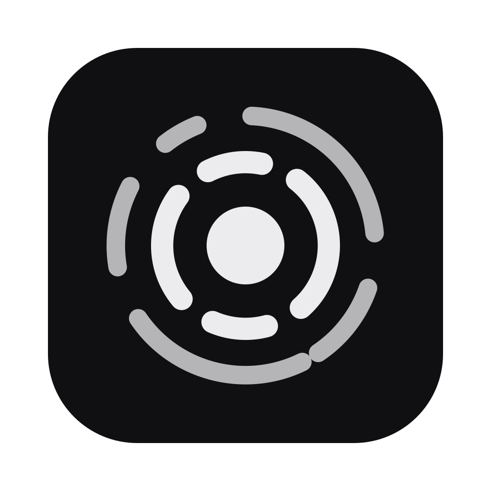
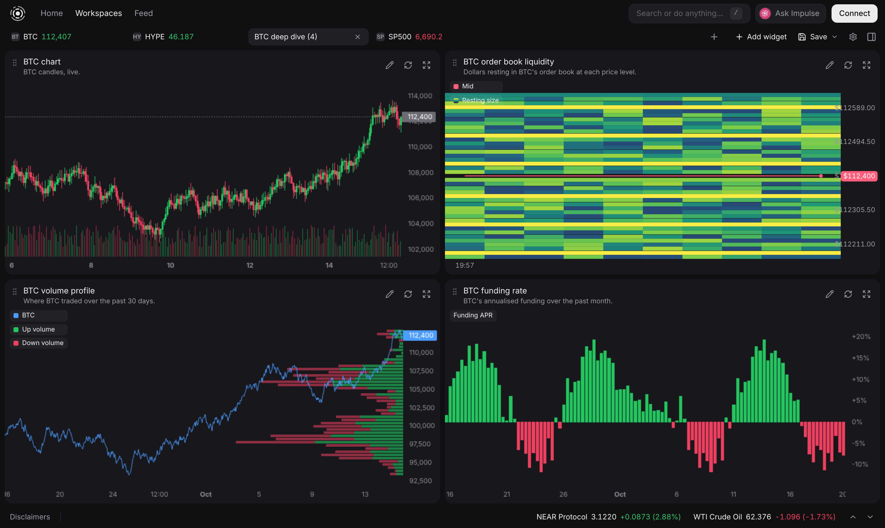
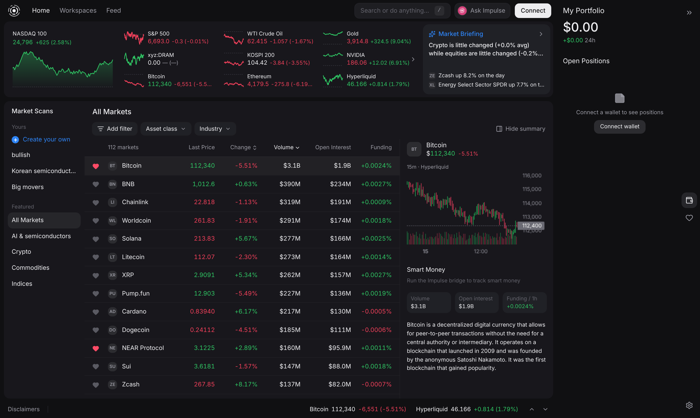
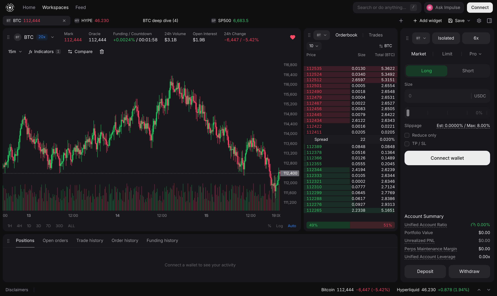
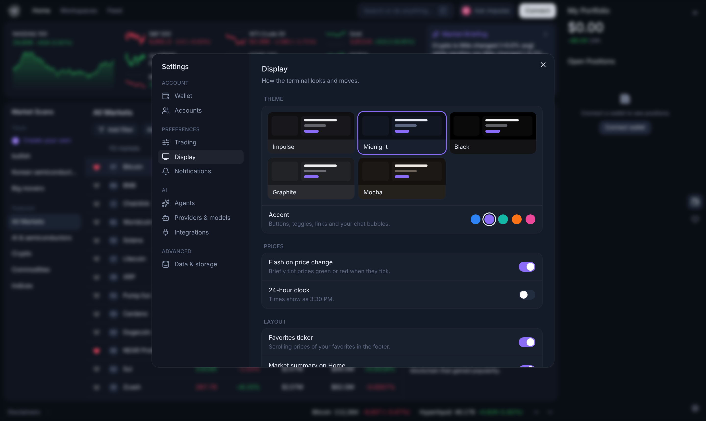

<div align="center">



# Impulse

**An AI trading terminal for Hyperliquid, driven by the coding agent you already use.**

Crypto perps and HIP-3 markets (equities, indices, commodities, FX) in one terminal. Ask in plain English and it builds live workspaces, watches the market for you, and drafts trades you approve with one click.


[](LICENSE)

</div>

> [!IMPORTANT]
> **This is a side project, and maintenance is light.** Issues and PRs may sit for a while or not get answered. If you want to build on Impulse, **fork it and make it your own**. That's the intended way to use this repo. See [Make it yours](#make-it-yours).



## Why Impulse

- **Bring your own AI.** No API keys or subscriptions in the app. Impulse drives the agent you already have installed: Claude Code, Codex, Grok, Gemini CLI, OpenCode, Cursor CLI, Amp, Qwen Code, Factory Droid, pi, oh-my-pi, or any custom command.
- **Ask, and it builds.** "Show me BTC liquidity, funding and volume profile side by side" turns into a live workspace in seconds. Replies can include live charts, tickers and widgets.
- **You stay in control.** The agent can only *propose* orders. It shows an editable ticket, and nothing executes until you press Place. Trading is non-custodial and signed in your browser.
- **Alerts that keep running.** Price, 24h change, funding, open interest, smart-money flow and news alerts run in a local bridge, so they keep firing with the tab closed. They reach you in the app, as desktop notifications, and on your phone via [ntfy](https://ntfy.sh).
- **More than crypto.** Hyperliquid's HIP-3 markets bring NVDA, the S&P 500, gold, crude and FX into the same terminal as BTC.
- **A terminal that feels fast.** Incremental charts, a virtualised market table, drag-to-swap widget grids, a floating or docked chat, a command palette (<kbd>/</kbd> or <kbd>⌘K</kbd>), and five themes with accent colours.
- **Web or desktop.** Run it in the browser, or as an Electron app that bundles everything.

## A look around

| Markets at a glance | Full trading layout |
| --- | --- |
|  |  |

| Themes & accents |
| --- |
|  |

## Quick start

```sh
pnpm install
pnpm dev          # web app (Vite) + local bridge
```

Open the URL Vite prints, connect a wallet, and press **Ask Impulse**. `pnpm web` and `pnpm bridge` run the two halves separately.

You'll need Node ≥ 22.18 and at least one supported agent CLI on your `PATH` for the AI features. Market data and trading work without one.

## Desktop app

Impulse also ships as an Electron app. It bundles the bridge, so there's nothing to run in a terminal.

```sh
pnpm app:dev      # Vite with hot reload inside the Electron window
pnpm app          # build, then run the production app locally
pnpm dist         # package for this OS → release/ (dist:mac, dist:win, dist:linux for a specific one)
```

- The main process (`electron/main.ts`) starts `bridge/server.ts` with Electron's own Node, so users don't need Node installed. If a bridge is already listening on `7420` (e.g. `pnpm dev`), the app uses that one instead.
- The UI is served from `impulse://app/`, so local storage (workspaces, layouts, chats) persists across launches.
- Packaged builds keep bridge state in the OS user-data folder (Help ▸ Open data folder) instead of `.impulse/`; the bridge log is under Help ▸ Bridge log.
- On macOS the app keeps running with its window closed, so alerts keep firing and arrive as native notifications.
- Wallets in the app:
  - **Browser wallet** (Phantom, MetaMask, Rabby, any extension): Electron can't load extensions, so Connect opens a small pairing page (`wallet.html`) in your normal browser. Pick the wallet there and keep the tab open. The bridge relays every wallet request (connect, enabling trading, deposits, withdrawals) to it, and you approve in the extension as usual (`bridge/wallet.ts`, `src/wallet/browserWallet.ts`).
  - **Coinbase Wallet** opens its own popup window inside the app.
  - **WalletConnect / mobile wallets** pair by QR code when `VITE_WALLETCONNECT_PROJECT_ID` is set at build time.
- Builds are unsigned. For signed/notarised macOS builds set the usual electron-builder env vars (`CSC_LINK`, `CSC_KEY_PASSWORD`, `APPLE_ID`, …) before `pnpm dist:mac`.

Optional `.env.local`:

```sh
VITE_WALLETCONNECT_PROJECT_ID=…   # enables WalletConnect / mobile wallets (extension wallets work without it)
```

## Built with

| Area | Built on |
| --- | --- |
| UI kit | shadcn/ui (Radix) + Tailwind v4, Inter, lucide icons |
| Motion | Motion (shared-layout chat morph, springs, blur-ins) |
| Charts | TradingView lightweight-charts v5; canvas order-book heatmap |
| Grid | react-grid-layout v2 (custom workspaces), react-resizable-panels (market layout) |
| Toasts | Sonner |
| Market data & trading | `@nktkas/hyperliquid` (REST + WebSocket), main dex + `xyz` HIP-3 dex |
| Wallet | wagmi + RainbowKit on Arbitrum; deposits via the official USDC bridge |
| Agent tools | Model Context Protocol (`@modelcontextprotocol/sdk`) |

**Trading** is non-custodial. On first order Impulse asks your wallet to approve a locally generated Hyperliquid agent key (the same pattern the official app uses), then signs orders in the browser. The agent can only *propose* orders (`propose_order` shows an editable ticket); nothing executes until you press Place.

## Workspaces

- **Custom workspaces** sit on a 24 × 24 grid that fills the screen. Drag a widget by its header; drop it on another widget to swap the two, or on open space to place it there. Resize from any edge or corner. Widgets that share an edge resize together, like split panes, and stop at each other's minimum size. Save ▸ Tidy layout goes back to even auto-tiling.
- **Market tabs** (chart · order book · ticket · positions) have draggable splits. The sizes are shared by every market tab.
- **The Impulse chat** floats as a window you can drag by its header and resize from any edge or corner (double-click the header to reset). On a workspace, drop it on the right edge to dock it; the docked panel resizes from its left edge, and dragging its header out floats it again. Position and sizes are remembered.

## The bridge

`bridge/` is a small Node daemon (no build step, Node ≥ 22.18 strips the types):

```
browser ──ws──▶ bridge ──spawn──▶ your harness (claude -p, codex exec, grok -p, …)
                  ▲                       │
                  └──── POST /call ◀── impulse MCP server (bridge/mcp.ts)
```

- The picker under the chat box shows the provider (harness) and model each chat runs on; switch either per chat, search the suggested models, or type any model id. Settings ▸ AI agent sets a default model per provider (used when a chat is on *Default*). The model goes to the harness's own model flag (`$IMPULSE_MODEL` for a custom command); suggestions come from `bridge/harnesses.ts`, plus `opencode models` when OpenCode is installed.
- **Custom agents** (Settings ▸ Agents, or the name at the top of any chat): give Impulse a name, a glyph, a colour and your own instructions — a persona, a strategy, a house style. The instructions are appended to Impulse's system prompt for that agent's replies (they can override style, not tool use: agents still only propose orders). Each chat talks to one agent and can switch; switching starts a fresh harness session with the transcript carried over. Agents live in the browser's local storage (`impulse.agents`).
- **Live components in replies**: agents write tokens in their text and the chat renders them in the bubble — `[[ticker:BTC,ETH]]` (inline live price chips), `[[chart:xyz:CL:4h]]` (candle chart), `[[widget:funding:BTC]]` (any widget kind). Charts mount when scrolled into view.
- **Workspaces over MCP**: besides building (`create_workspace`, `add_widget`, `add_note`), agents can `list_workspaces` (widgets and their 24 × 24 grid layout), `arrange_workspace` (positions/sizes, or `tidy`), `swap_widgets`, `update_widget`, `remove_widget`, `rename_workspace` and `reorder_workspaces`.
- Each chat message spawns the selected harness in a run folder with the Impulse MCP server configured for it. Harnesses without MCP (pi, Droid, custom) get a shell CLI instead: `node bridge/cli.ts <tool> '<json>'`.
- Tool calls stream back as the "Working · N steps" list. Data tools run in the bridge; UI tools (create workspace, add widget, create scan, propose order, read portfolio) run in the tab that sent the message.
- **Alerts** (price, 24h change, funding, open interest, smart money, news) live in the bridge, so they keep running with the tab closed. Hits go to the app, macOS notifications, and your phone via an [ntfy](https://ntfy.sh) topic set in Settings.
- **Smart money** = Hyperliquid accounts with ≥ $1M all-time PnL (from the public leaderboard); the bridge polls the largest 100 and aggregates their long/short notional per market.
- **News** comes from GDELT (free, keyless).
- Open interest history isn't exposed by Hyperliquid, so the bridge records it hourly.

The bridge listens on `127.0.0.1:7420` and rejects non-localhost origins. State lives in `.impulse/` (gitignored).

Use the tools from your harness directly too:

```sh
claude mcp add impulse -- node "$(pwd)/bridge/mcp.ts"
```

## Dev scripts

- `node scripts/shot.mjs <path> <out.png>` — screenshot a route
- `node scripts/readme-shots.mjs` — regenerate the README screenshots in `docs/` against mocked market data (`CHROMIUM=<path>` to use a specific browser)
- `node scripts/e2e-chat.mjs "<prompt>" <outDir> [path]` — drive a full chat run in a headless browser
- `node scripts/harness-check.mjs claude grok opencode …` — confirm each harness can call Impulse tools
- `node scripts/perf.mjs [seconds]` — renderer CPU per page against a mocked Hyperliquid feed (no network needed); run it against `pnpm build && pnpm preview --port 5180`. `DRAG=1` times a widget drag and resize, `PROFILE=n` lists the top n functions (build with `--sourcemap` for names), `TRACE=1` splits paint/commit/script, `LATENCY=ms` simulates network delay for the startup timing

## Make it yours

Impulse is meant to be forked. Some good places to start:

| You want to… | Look at |
| --- | --- |
| Add a theme or accent | `src/lib/theme.ts` (each theme is a dozen colour tokens) |
| Add a widget | `src/components/widgets/` and `registry.tsx`, plus `WIDGET_META` in `src/store/workspaces.ts` |
| Give the agent a new tool | `bridge/tools.ts` (data tools) and `src/lib/uiTools.ts` (tools that act on the UI) |
| Support another agent CLI | `bridge/harnesses.ts` |
| Add an alert type | `bridge/alerts.ts` (alerts run in the bridge so they survive a closed tab) |
| Re-shoot the README screenshots | `node scripts/readme-shots.mjs` (mocked market data, no network needed) |

If you build something cool on a fork, feel free to open an issue to show it off. A reply may take a while, though.

## Disclaimer

Impulse is experimental software, not financial advice. Perpetual futures are leveraged and you can lose more than you expect, quickly. AI agents can be confidently wrong, so read every proposed order before you press Place. You use this at your own risk.

## License

[MIT](LICENSE). Fork it, change it, ship it.
